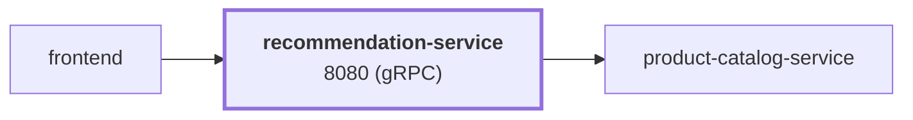

# recommendation-service

service · platform-demo

A gRPC service that returns product recommendations for the platform-demo e-commerce platform. For each request it fetches the **entire** product list from `product-catalog-service`, removes the products the user already has, and returns a random sample of up to 5 product IDs. It is stateless and is called only by `frontend`.

Runtime<strong>Python 3.12</strong><small>Python</small>

Listens on<strong>8080</strong><small>gRPC</small>

State<strong>Stateless</strong>

Image<strong>recommendation-service</strong><small>mladenovskistefan/</small>

## Where it sits

Called by `frontend`. It calls `product-catalog-service`.

## At a glance

| | |
|---|---|
| **Language / runtime** | Python 3.12 in the image (3.13 pinned for local dev), `grpcio` |
| **Image** | `mladenovskistefan/recommendation-service` |
| **Protocol / port** | gRPC (HTTP/2, plaintext) on `8080` |
| **Metrics** | Pushed over OTLP/gRPC to Alloy → Mimir every 15 s (no scrape endpoint). Dashboard names: `rpc_server_duration_seconds_{bucket,count,sum}`, `rpc_server_requests_total`, `rpc_server_active_requests` |
| **Health** | `grpc.health.v1.Health/Check` on `8080` — static `SERVING`, does **not** reflect catalog availability |
| **State** | None |
| **Depends on** | `product-catalog-service:3550` (`ListProducts`) |
| **Called by** | `frontend` (`ListRecommendations`) |
| **gRPC reflection** | Not enabled — pass `-proto` to `grpcurl` |

## Find it elsewhere

<h4><a href="https://argocd.platform-demo.test/applications/argocd/dev-recommendation-service">Argo CD</a></h4>
Sync and health of <code>dev-recommendation-service</code>.

<h4><a href="https://grafana.platform-demo.test/d/recommendation-service-overview">Grafana</a></h4>
Latency, traffic and errors (<code>recommendation-service-overview</code>).

<h4><a href="https://github.com/platform-boutique/app-recommendation-service">Repository</a></h4>
Source, pull requests and releases of <code>app-recommendation-service</code>.

!!! info "Part of the platform-demo platform"
    Cross-cutting facts (service wiring, observability contract, Kubernetes translation, CI/CD) are in the
    [master reference](https://github.com/platform-boutique/platform-demo-docs). This site only describes recommendation-service.
